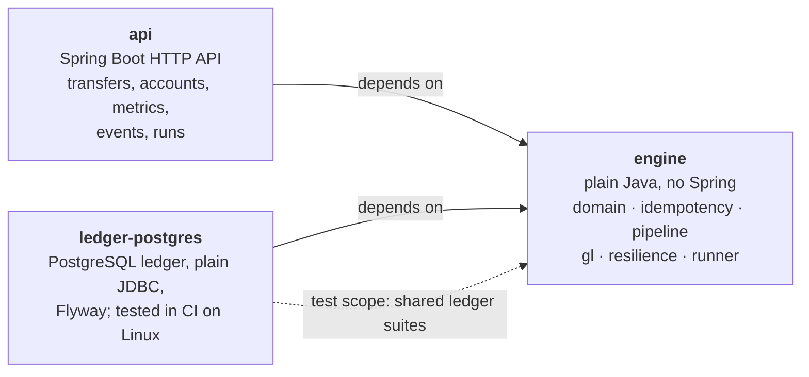

# Settlement Lab

A Java engine that moves money between accounts on many threads at once, and checks after every run
and in its tests that no money is created, lost or applied twice, even when transfers arrive twice,
the downstream general ledger fails, or load exceeds capacity. It then measures two concurrency
strategies (ordered locking and lock-free compare-and-set) and two threading models against each other.

[](LICENSE)
[](.github/workflows)
[](https://github.com/TheSiddheshFulawade/settlement-lab/releases/tag/v1.0.0)

Open source (MIT). Nothing is hosted: you run it on your own machine. Write-up:
https://siddheshfulawade.com/projects/settlement-lab

## What is checked

Six invariants, checked by `InvariantChecker` at the end of every runner cell. The tests check them
too: the five ledger invariants by jqwik properties and stress tests against both in-memory ledgers
and, in Linux CI, the PostgreSQL ledger; the general-ledger invariant by end-to-end tests with
injected faults. Terms: the *ledger* is the engine's own account ledger; a *posting* is its
one record per applied transfer (sequence, transfer id, source, target, amount); the *general ledger*
is a downstream system that receives one entry per posting.

1. **Money is conserved.** The sum of all balances at the end equals the opening total.
2. **No balance goes below zero.** A transfer larger than the source balance is rejected
   (`REJECTED_FUNDS`) and writes nothing.
3. **No transfer is applied twice.** The runner resends 2 % of transfers, and the concurrency tests
   send the same id from many threads at the same moment.
4. **The postings explain the balances.** Opening balances plus every posting give exactly the final
   balances.
5. **Postings match the answers.** Every transfer answered `POSTED` has a posting, and every posting
   was answered `POSTED`.
6. **The general ledger reconciles with the ledger.** After the FLAKY cells (errors and lost
   acknowledgements) and the OUTAGE cells, it holds exactly the ledger's postings, each once, field
   for field.

All six passed in all 12 cells of the committed run below. Passing tests and runs show that no
violation was found; they are not a formal proof.

## Results at a glance

| No faults, 100,000 transfers | Throughput/s | p50 µs | p99 µs |
|---|---:|---:|---:|
| Ordered locking, platform threads | 248,861 | 183 | 2,008 |
| Ordered locking, virtual threads | 181,706 | 340 | 800 |
| CAS, platform threads | 54,027 | 878 | 9,488 |
| CAS, virtual threads | 55,465 | 1,011 | 3,779 |

- Ordered locking beat CAS by 2.9x to 4.6x on throughput across all six pairs (with and without
  faults). CAS copies the whole 80 KB balance table per transfer at 10,000 accounts, so this ratio
  depends on the account count.
- In the OUTAGE cells the fake general ledger refuses every call from 50 ms after it is created, for
  1 s. The breaker opened once in each OUTAGE cell, the outbox peaked at 86,480 to 95,181 postings
  (most of the cell's postings), and every posting reached the general ledger afterwards.
- **Conditions:** one run of the runner with its defaults (10,000 accounts, 20 % of transfers on 20 hot
  accounts, 2 % duplicate resends, seed 20261119, 8 workers, 64 closed-loop clients) on a cloud
  container, Intel Xeon @ 2.10 GHz, 4 cores, Linux amd64, JDK 21.0.13; committed in `3eb119a`
  ([results.md](results/results.md), [results.json](results/results.json)).
- **Not proven:** this is one run on 4 cores, with no repeat and no confidence interval, so the
  directions are worth more than the exact ratios. It has not been run on JDK 25 for the record. The
  general ledger is an in-process fake. The engine's ledgers and its outbox live in memory: the
  guarantees hold within one process run, not across a crash or restart. The PostgreSQL ledger has
  no numbers yet. None of it comes from
  a production system. The full table and what it does and does not say are under [Results](#results).

## Run it with one command

Needs Git and JDK 21 or newer (25 recommended). On Windows, use Git Bash.

```bash
git clone https://github.com/TheSiddheshFulawade/settlement-lab.git
cd settlement-lab
./mvnw -q -pl engine compile exec:java -Dexec.args="--transfers 10000 --out my-results"
```

This runs all 12 cells (2 ledgers x 2 thread models x 3 fault profiles) on 10,000 transfers, prints
the table, checks every invariant, and exits 1 if any cell fails. On an AMD laptop with 16 logical
processors (Windows 11, JDK 25.0.1, Maven dependencies already downloaded) it took 45 s on 2026-11-27:
12 of 12 `PASS`, exit 0. At this size the locking cells finish before the outage starts (50 ms in), so
their OUTAGE rows show no fault; the 100,000-transfer matrix below exercises it in every cell.
The first build also downloads Maven and the dependencies, so it takes longer on a new machine. A
run this small is a check that it works, not a benchmark. The full commands (tests, the 100,000-transfer
matrix, the HTTP API and its load check) are under [Run it locally](#run-it-locally).

## How it works, in three pictures

**One transfer, end to end.** A duplicate is answered at the idempotency store and never applied
twice; the caller's answer never waits for the general ledger.


**Why ordered locking cannot deadlock, and how CAS retries instead of locking.**


**When the general ledger is down:** fail fast, keep every posting in the outbox, resend later.


The animations stop when your system asks for reduced motion. A 9-page explainer with the full
low-level design is in [docs/explainer/Settlement-Lab-LLD.pdf](docs/explainer/Settlement-Lab-LLD.pdf).

## Modules



The engine never imports Spring: Spring is not even on its classpath, and ArchUnit enforces the
package rules inside it (the `domain` package imports `java.*` only). The API runs on the in-memory
ledgers; `ledger-postgres` is not wired into it.

## Key decisions

- **Ordered per-account locks** instead of one global lock or `tryLock` with back-off: deadlock is
  impossible by construction, and transfers on unrelated accounts run in parallel
  ([L-02](docs/DECISIONS.md#ledger-l-02)).
- **A lock-free CAS ledger as the comparison**: one immutable balance array swapped with
  `compareAndSet`. It lost to locking at 10,000 accounts, a valid result
  ([L-03](docs/DECISIONS.md#cas-ledger-l-03)).
- **Idempotency by `putIfAbsent` of one future per transfer id**: a duplicate shares the original's
  answer, and a transfer that was never processed releases its id for a retry
  ([L-04](docs/DECISIONS.md#idempotency-l-04)).
- **A bounded queue with a 100 ms offer** instead of an unbounded queue: overload is answered with
  `QUEUE_FULL`, not with an ever-growing queue ([L-05](docs/DECISIONS.md#engine-intake-and-workers-l-05)).
- **The ledger posting is the source of truth**; the general ledger gets each posting by a direct
  send, with an outbox for failed sends, and is keyed by transfer id, so at-least-once delivery gives an exactly-once effect within one process
  run; the v1 outbox is in memory and does not survive a restart, the PostgreSQL transactional
  outbox does ([L-06](docs/DECISIONS.md#general-ledger-faults-and-outbox-l-06)).
- **Retry inside a circuit breaker** (Resilience4j): an open breaker fails fast and is never retried
  ([L-07](docs/DECISIONS.md#retry-and-circuit-breaker-l-07)).
- **PostgreSQL (v3)**: ordered `FOR UPDATE` row locks at `READ COMMITTED`, idempotency by the primary
  key, and a transactional outbox read with `SKIP LOCKED`
  ([V3-03](docs/DECISIONS.md#postgresql-pessimistic-ledger-v3-03),
  [V3-04](docs/DECISIONS.md#idempotency-by-database-key-v3-04),
  [V3-06](docs/DECISIONS.md#transactional-outbox-and-lease-based-relay-v3-06)).

Every decision, with the alternatives and the reasons, is in [docs/DECISIONS.md](docs/DECISIONS.md).

## Scope

*Settlement* here means applying a transfer between two accounts held in one ledger (a book
transfer): there is no clearing, netting, interbank settlement, currency, value date or cut-off.

v1 is a plain Java library and a command-line runner (module `engine`). v2 wraps it in a Spring Boot
HTTP API (module `api`): it is built, tested and hardened, and runs on your own machine only. It is
not hosted anywhere: the owner dropped deployment (V2-06) on 2026-11-26. v3 adds a PostgreSQL ledger
(module `ledger-postgres`), tested in CI on Linux, not wired into the API, and not measured yet (see
[Database results](#database-results)). [SPEC.md](SPEC.md) has the requirements (REQ-LAB-001 to 016,
REQ-API-001 to 010, REQ-RUN-001 to 013), the design and the task lists. The HTTP contract of the runs
API is in [docs/api-contract.md](docs/api-contract.md).

## Design

| Package | What it holds | May import |
| ------- | ------------- | ---------- |
| `domain` | `Money` (long minor units), `Transfer`, `Posting`, `Ledger` port, `LockingLedger`, `CasLedger`, `InvariantChecker`, `PostingPublisher` port | `java.*` only |
| `idempotency` | `IdempotencyStore` | `domain` |
| `pipeline` | `SettlementEngine`, bounded intake, `WorkerPool` (`PLATFORM` / `VIRTUAL`) | `domain`, `idempotency` |
| `gl` | `GeneralLedgerPort`, `FakeGeneralLedger`, `FaultProfile`, `OutboxPublisher` | `domain` |
| `resilience` | `ResilientPublisher` (Resilience4j retry inside a circuit breaker) | `domain`, `gl`, Resilience4j |
| `runner` | `Main`, `Workload`, `ScenarioRunner`, results writers | everything |

ArchUnit enforces the last column, no Spring anywhere, and no package cycles.

```text
submit(transfer)
  -> IdempotencyStore      duplicate id? return the original outcome
  -> TransferValidator     invalid? REJECTED_INVALID, never queued
  -> bounded queue         full for longer than offerTimeout? QUEUE_FULL (back-pressure)
  -> worker (N, platform or virtual)
       -> Ledger.applyWithResult   POSTED / REJECTED_FUNDS, atomically
       -> caller's future completes          (does not wait for the GL)
       -> OutboxPublisher.publish(posting)   returns at once
            -> sender thread -> ResilientPublisher (retry, breaker) -> general ledger
            -> on failure: outbox -> relay retries until the GL accepts it
```

- **Ledgers.** `LockingLedger`: one `ReentrantLock` per account, both accounts locked in ascending
  id order, so a wait cycle (deadlock) is impossible. `CasLedger`: the whole balance table is an
  immutable array swapped with `compareAndSet`, retried on conflict; no locks at all.
- **Idempotency.** One `CompletableFuture` per transfer id, installed with `putIfAbsent`: exactly one
  caller processes it, every duplicate gets the same answer.
- **Back-pressure.** An `ArrayBlockingQueue` and `offer(timeout)`: a caller waits at most 100 ms, then
  hears `QUEUE_FULL` and may retry with the same id.
- **Resilience.** The ledger posting is the source of truth; the GL is eventually consistent. Retry
  absorbs blips, the circuit breaker fails fast during outages, the outbox keeps every posting until the GL takes it
  (in memory in v1, so only while the process runs; the v3 PostgreSQL outbox survives a restart), and the GL is keyed by transfer id, so a resend is harmless: exactly-once effect.
- **Proof.** jqwik properties (including agreement with a sequential model) and stress tests run
  against both ledgers; every runner cell ends with `InvariantChecker`. Study notes for each module
  are in [docs/learn](docs/learn).

## Results

One run of `./mvnw -q -pl engine compile exec:java` (defaults: 10,000 accounts, 100,000 transfers, 20 % of
transfers within 20 hot accounts, 2 % duplicate resends, seed 20261119, 8 workers, 64 closed-loop
clients). Full output: [results/results.md](results/results.md) and
[results/results.json](results/results.json).

**Machine:** cloud container, Intel Xeon @ 2.10 GHz, 4 cores, Linux amd64, **JDK 21.0.13**. JDK 25
was not available in that container, so this run is on 21; a run on JDK 25 is still to do.
Numbers are from this lab on that machine, a single run, never from a production system.

| Ledger | Threads | Faults | Transfers | Throughput/s | p50 µs | p99 µs | Rejected | Duplicates | Retries | Breaker opens | Outbox peak | Invariants |
|---|---|---|---|---|---|---|---|---|---|---|---|---|
| LOCKING | PLATFORM | NONE | 100,000 | 248,861 | 183 | 2,008 | 853 | 2,006 | 0 | 0 | 0 | PASS |
| LOCKING | PLATFORM | FLAKY | 100,000 | 215,823 | 197 | 2,680 | 825 | 2,006 | 16,739 | 0 | 3 | PASS |
| LOCKING | PLATFORM | OUTAGE | 100,000 | 172,734 | 228 | 2,840 | 808 | 2,006 | 54 | 1 | 90,036 | PASS |
| LOCKING | VIRTUAL | NONE | 100,000 | 181,706 | 340 | 800 | 825 | 2,006 | 0 | 0 | 0 | PASS |
| LOCKING | VIRTUAL | FLAKY | 100,000 | 225,608 | 237 | 735 | 814 | 2,006 | 16,763 | 0 | 3 | PASS |
| LOCKING | VIRTUAL | OUTAGE | 100,000 | 165,981 | 368 | 1,342 | 832 | 2,006 | 52 | 1 | 86,480 | PASS |
| CAS | PLATFORM | NONE | 100,000 | 54,027 | 878 | 9,488 | 820 | 2,006 | 0 | 0 | 0 | PASS |
| CAS | PLATFORM | FLAKY | 100,000 | 49,865 | 886 | 8,784 | 830 | 2,006 | 16,777 | 0 | 3 | PASS |
| CAS | PLATFORM | OUTAGE | 100,000 | 59,859 | 829 | 6,282 | 813 | 2,006 | 52 | 1 | 94,167 | PASS |
| CAS | VIRTUAL | NONE | 100,000 | 55,465 | 1,011 | 3,779 | 826 | 2,006 | 0 | 0 | 0 | PASS |
| CAS | VIRTUAL | FLAKY | 100,000 | 51,813 | 1,016 | 3,507 | 821 | 2,006 | 16,762 | 0 | 3 | PASS |
| CAS | VIRTUAL | OUTAGE | 100,000 | 54,297 | 1,046 | 3,409 | 802 | 2,006 | 52 | 1 | 95,181 | PASS |

What the numbers say (and what they do not):

- **Ordered locking beat CAS by 2.9x to 4.6x** on throughput (the range over the six pairs), with a
  lower p50 and p99 in every pair. With 10,000 accounts, every CAS write copies an 80 KB balance array,
  and a failed swap throws that copy away and starts again; per-account locks touch two accounts only.
  CAS losing here is a valid result: its cost grows with the table size and with contention. With a
  small table and many readers the balance could tip the other way; this run did not test that.
- **Platform vs virtual threads: no clear throughput winner** at the same cap (N = 8): platform was
  faster in three pairs and virtual in three. Platform was 1.37x faster for locking with no faults
  (248,861 vs 181,706/s); in the other five pairs the faster mode led by 2.7 % to 10.2 %. The
  work is short and CPU-bound, so virtual threads have little blocking to hide. **Virtual threads
  had the lower p99 in all six pairs** (for example 800 vs 2,008 µs), with a higher p50 in all six
  (by 14.7 % to 85.8 %).
  One run on 4 cores: the direction is worth a repeat run, the exact ratios are not to be trusted.
- **Faults did not collapse throughput**: against the NONE cell with the same ledger and threads, the
  largest drops were 30.6 % (OUTAGE) and 13.3 % (FLAKY), both for locking on platform threads. Locking
  on virtual threads was 24.2 % *faster* under FLAKY and 8.7 % slower under OUTAGE; CAS moved between
  −7.7 % and +10.8 %. One run cannot separate such differences from noise. Publishing runs off the
  worker threads, so these rates are not general-ledger delivery rates (the runs API,
  paced at 2,000 transfers/s, needs about 14 s on Linux CI runners to submit and deliver 20,000 under FLAKY:
  `docs/learn/v2-07-runs-api.md`). FLAKY needed 16,739 to 16,777 retries per cell, and the
  outbox never held more than 3 postings at once. OUTAGE opened the breaker once per cell; the outbox
  peaked at 86,480 to 95,181 postings (the breaker's 2 s open wait outlasts every OUTAGE cell, 0.58 s to
  1.84 s) and drained them all afterwards.
- **Every invariant passed in every cell**: total conserved, no negative balance, each transfer
  posted at most once, postings explain the balances, postings match accepted transfers, and the
  GL holds exactly the ledger's postings.

### Database results

`results/results-db.md` (pessimistic and optimistic PostgreSQL cells) is produced locally, not in CI, with
the command below (needs Docker). There are no database numbers yet.

```bash
mvnw.cmd -Pdb -pl ledger-postgres -am test-compile exec:java -Dexec.classpathScope=test -Dexec.mainClass=com.siddheshfulawade.settlementlab.postgres.DbResultsMain
```

**Known broken.** This command was run on 2026-11-24 and fails with `ClassNotFoundException` on the
parent module: `-am` makes `exec:java` run on the parent project first, before any Docker step. The fix
is open, so no working command is printed here yet.

## Run it locally

Nothing is hosted: you clone the repository (or release v1.0.0) and run everything on your own machine.
Needs JDK 21 or newer (25 recommended) Git, and `curl` for steps 4 and 5 (it ships with Git
for Windows and with Windows 10 and later); nothing else. On Windows, run them in
Git Bash (`./mvnw` works there; `mvnw.cmd` too). Every command below was run on 2026-11-26 on an
AMD laptop with 16 logical processors, Windows 11, JDK 25.0.1, unless it says "proved in CI".

**1. The tests (the single gate).** Compile, all tests, 85 % line coverage, format and architecture rules:

```bash
./mvnw verify
```

Proved in CI on every pull request and every push to main: Ubuntu and Windows × JDK 21 and 25, for
example [run 45872859770](https://github.com/TheSiddheshFulawade/settlement-lab/actions/runs/45872859770)
(the fix-03 pull request).
On the laptop only the engine module was run (`./mvnw -pl engine verify`: 181 tests, coverage met).
The database tests need Docker and run with `-Pdb` on Linux CI only (Ubuntu runs `./mvnw verify -Pdb`).
`./mvnw spotless:apply` fixes formatting (on the laptop only `./mvnw spotless:check` was run: it
passed).

**2. The scenario matrix** (12 cells; exits 1 if any cell fails: an invariant, or the general
ledger not catching up within 5 minutes). Without `--out` it overwrites
the committed `results/`, so write elsewhere:

```bash
./mvnw -q -pl engine compile exec:java -Dexec.args="--transfers 100000 --out my-results"
```

On the laptop: all 12 cells `PASS`, exit 0, 524 s in all. Much of that is likely the general ledger catching up
after the transfers (one traced CAS FLAKY cell took 128.8 s to drain; the split of the 524 s was not
measured; fix-03 in [DECISIONS.md](docs/DECISIONS.md#runner-and-results-l-08)). These laptop numbers are a check that the
command works, not the committed results: those are in the Results section, from one run on a 4-core
container.

Options: `--accounts`, `--transfers`, `--hot-accounts`, `--hot-percent`, `--duplicate-percent`,
`--seed`, `--out`.

**3. The HTTP API** (settings under `settlement.*`, see `api/src/main/resources/application.yml`). Build
it, then start it; it listens on Spring Boot's default port, `http://localhost:8080`:

```bash
./mvnw -q -pl api -am package -DskipTests
```

```bash
java -jar api/target/settlement-lab-api-0.1.0-SNAPSHOT.jar --settlement.ledger=CAS --settlement.faults=FLAKY
```

**4. One run over HTTP with curl.** Start a run (answer: `202` with a `runId`), then read its report:

```bash
curl -s -i -X POST http://localhost:8080/api/v1/runs -H "Content-Type: application/json"   -d '{"ledger":"LOCKING","threads":"VIRTUAL","faults":"FLAKY","transfers":2000,"duplicatePercent":2}'
```

```bash
curl -s http://localhost:8080/api/v1/runs/<runId>
```

On the laptop: `202 Accepted`, then `"status":"DONE"`, 2,000 of 2,000 transfers in 1,652 ms, opening and
closing total 10,000,000, 39 duplicates sent and 0 applied, and all six invariants `"passed":true`
(`"allPassed":true`). To watch it live instead, `curl -N -H "Accept: text/event-stream"
http://localhost:8080/api/v1/runs/<runId>/events` streams `metrics` events and ends with the `report`
(a 2,000-transfer run is over in about 2 s, so start it straight after the POST). That `curl -N` form
was not run on the laptop; the load check in step 5 reads the same stream and passed
`RUN_ONE_REPORT_AND_IT_IS_LAST`.

For a server you keep running, add `-XX:+ExitOnOutOfMemoryError` after `java` ([fix-02 decisions](docs/DECISIONS.md#hardening-the-runs-api-fix-02)); the
laptop run above did not use it.

### The HTTP load check

**5.** With the API running, a black-box client can check it from the outside. The class is
`HttpLoadCheckMain`, in the api module's test sources, so it needs the test classpath. Two steps, both
run in Git Bash on Windows. First write the classpath to a file (the path **must be absolute**, and on
Windows in `D:/...` form):

```bash
mvnw.cmd -q -pl api -am test-compile org.apache.maven.plugins:maven-dependency-plugin:3.11.0:build-classpath "-Dmdep.outputFile=D:/path/to/settlement-lab/api/target/loadcheck.cp" -Dmdep.includeScope=test
```

Then run the check:

```bash
java -cp "api/target/test-classes;api/target/classes;$(cat api/target/loadcheck.cp)" com.siddheshfulawade.settlementlab.api.HttpLoadCheckMain http://localhost:8080
```

On Linux and macOS the same two commands should work with `./mvnw` and `:` instead of `;` in the
classpath. That form has not been tried yet. No `cmd.exe` or PowerShell form is given, because none was tried.

- Options: `--operations` (default 1,500), `--clients` (32), `--seed`, `--run-transfers` (2,000),
  `--ledger LOCKING|CAS`, `--threads PLATFORM|VIRTUAL`, `--runs-only`. Sizes outside their range are
  refused with exit 2: `--operations` and `--clients` at least 1, `--run-transfers` 1 to 20,000 (the
  server's own cap). A URL with a user name or password is refused too, and never printed.
- **Default mode** sends a seeded mix of transfers, then starts one run. It refuses any host that is not
  loopback (`localhost`, `127.x.x.x`, `::1`; names are checked as text, with no DNS lookup), because it
  sends thousands of transfers and is for a server you own.
- **`--runs-only`** does exactly one run and nothing else: no transfer, account or metrics request. Any
  host is allowed. Use it for a server that serves only runs, such as one started with the `prod` profile (REQ-API-010).
- **Exit codes:** 0 every check passed, 1 a check failed (or the check could not finish), 2 refused or
  bad arguments.

The client does not trust the server to behave: it uses no proxy, follows no redirect, and bounds every
request and body in time and size. All clients share one 120 s deadline for the transfer load, after
which they stop sending. An empty list of checks is never a pass.

What it proves: over real HTTP, the 9 transfer checks and 10 run checks (19 in all) all print `PASS`.
They are named (for example `TOTAL_CONSERVED`, `REPEATS_GET_ORIGINAL_STATUS`,
`GL_ONE_ENTRY_PER_POSTING`, `RUN_ALL_SIX_INVARIANTS_PASSED`), and a red line says what broke. One of
them, `MIX_PRODUCED`, fails if the load did not really produce posted, rejected-for-funds and invalid
transfers and a repeated request. So a very small `--operations` can turn it red. That is correct: a
load too small to produce the whole mix proves little, and a check list that passes on an empty load
would be worse. Three deliberate bugs in the engine turned the matching checks red (see
[docs/learn/v2-05-load-check.md](docs/learn/v2-05-load-check.md)).
What it does not prove: it is a correctness check, **not a benchmark**. It makes no throughput claim, and
a pass says nothing about speed. One real run against a local jar, on the laptop: 1,500 transfers decided
(2,175 transfer POSTs, 4,181 requests in all), 1,283 posted, 675 repeats answered with the original
status, total money 10,000,000 before and after, all 19 checks `PASS`. Run again on 2026-11-26 (JDK 25.0.1,
the two commands above): all 19 `PASS`, `RESULT PASS`, exit 0, 4,186 requests in 7.7 s.

## What v2 adds

A Spring Boot API (module `api`) that wraps `SettlementEngine` and keeps the engine framework-free. It
is built, tested and run locally, and **not deployed**: the owner dropped V2-06 (hosting) on 2026-11-26.
The `prod` profile and its allow-list stay in the code and its tests, but nothing runs them on a server.

- `POST /api/v1/transfers`, with idempotent replay and RFC 9457 problem details (REQ-API-001 to 003,
  REQ-API-009).
- `GET /api/v1/accounts/{id}` and `GET /api/v1/metrics` (REQ-API-004).
- `GET /api/v1/events`, a server-sent event stream of outcomes with a bounded buffer per subscriber
  (REQ-API-005).
- The runs API (designed for a portfolio page that is parked): start a run, watch live metrics, read the invariant report, with
  limits and CORS (REQ-RUN-001 to 013; contract in [docs/api-contract.md](docs/api-contract.md)).
  In the `prod` profile only the runs and `/actuator/health` are served (REQ-API-010).
- Graceful shutdown (REQ-API-006), and the black-box HTTP load check above.

Not in v2: a UI, authentication, and a database. The API runs on the in-memory ledgers; the PostgreSQL
ledger is v3 and stays a local and CI experiment.

## Licence

Open source under the MIT licence: see [LICENSE](LICENSE). Copyright (c) 2026 Siddhesh Fulawade.
