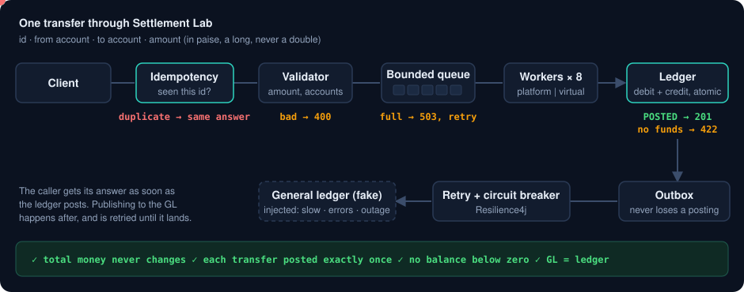
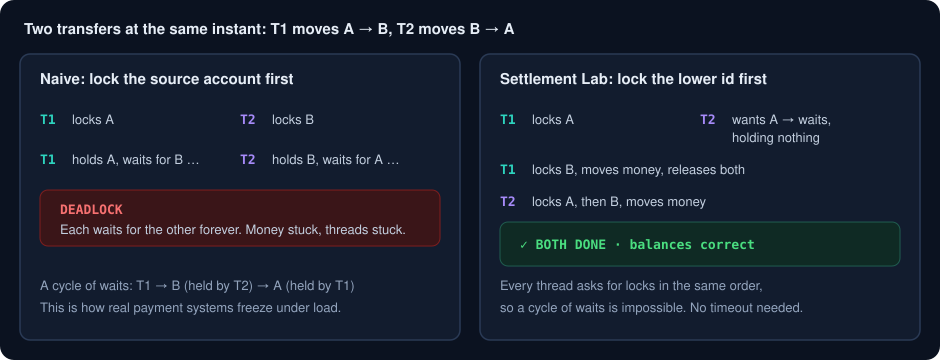
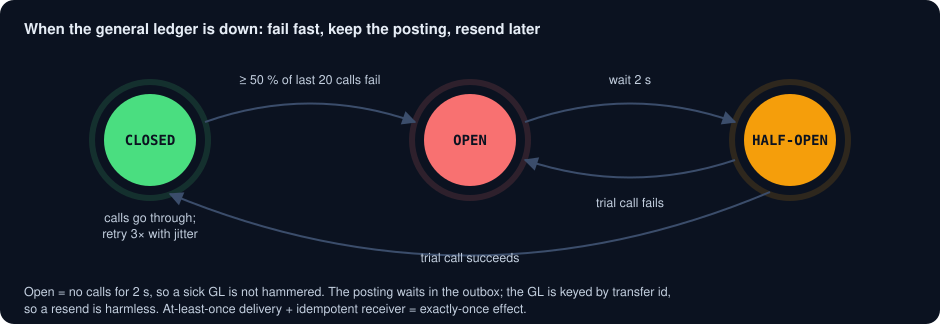

# Settlement Lab

A concurrency-safe settlement engine: move money between accounts concurrently without ever creating
or losing any, under duplicates, downstream failures and overload. Then measure locking and threading
choices. Write-up: https://siddheshfulawade.com/projects/settlement-lab

v1 is a plain Java library and a command-line runner (module `engine`). v2 wraps it in a Spring Boot
HTTP API (module `api`): it is built and tested, and not deployed yet (V2-06 waits for the owner's
yes). The engine still never imports Spring. v3 adds a PostgreSQL ledger (module `ledger-postgres`),
tested in CI on Linux, not wired into the API, and not measured yet (see Database results).
[SPEC.md](SPEC.md) has the requirements (REQ-LAB-001 to 016, REQ-API-001 to 010, REQ-RUN-001 to 013),
the design and the task lists. The HTTP contract of the runs API is in
[docs/api-contract.md](docs/api-contract.md).

## Problem

Many callers move money between accounts at the same time. The engine must never create or lose
money, never apply the same transfer twice even when it arrives twice, stay responsive when the
downstream general ledger (GL) is slow or down, and push back instead of falling over when load
exceeds capacity. Then: how do two locking strategies and two threading models compare?

## How it works, in three pictures

**One transfer, end to end.** A duplicate (red) is answered at the idempotency store and never applied twice.



**Why ordered locking cannot deadlock.**



**When the general ledger is down:** fail fast, keep the posting in the outbox, resend later.



A 9-page explainer with the full low-level design is in [docs/explainer/Settlement-Lab-LLD.pdf](docs/explainer/Settlement-Lab-LLD.pdf).

## Design

| Package | What it holds | May import |
| ------- | ------------- | ---------- |
| `domain` | `Money` (long minor units), `Transfer`, `Posting`, `Ledger` port, `LockingLedger`, `CasLedger`, `InvariantChecker`, `PostingPublisher` port | `java.*` only |
| `idempotency` | `IdempotencyStore` | `domain` |
| `pipeline` | `SettlementEngine`, bounded intake, `WorkerPool` (`PLATFORM` / `VIRTUAL`) | `domain`, `idempotency` |
| `gl` | `GeneralLedgerPort`, `FakeGeneralLedger`, `FaultProfile`, `OutboxPublisher` | `domain` |
| `resilience` | `ResilientPublisher` (Resilience4j retry inside a circuit breaker) | `domain`, `gl`, Resilience4j |
| `runner` | `Main`, `Workload`, `ScenarioRunner`, results writers | everything |

ArchUnit enforces the last column, no Spring anywhere, and no package cycles.

```text
submit(transfer)
  -> IdempotencyStore      duplicate id? return the original outcome
  -> TransferValidator     invalid? REJECTED_INVALID, never queued
  -> bounded queue         full for longer than offerTimeout? QUEUE_FULL (back-pressure)
  -> worker (N, platform or virtual)
       -> Ledger.applyWithResult   POSTED / REJECTED_FUNDS, atomically
       -> caller's future completes          (does not wait for the GL)
       -> OutboxPublisher.publish(posting)   returns at once
            -> sender thread -> ResilientPublisher (retry, breaker) -> general ledger
            -> on failure: outbox -> relay retries until the GL accepts it
```

- **Ledgers.** `LockingLedger`: one `ReentrantLock` per account, both accounts locked in ascending
  id order, so a wait cycle (deadlock) is impossible. `CasLedger`: the whole balance table is an
  immutable array swapped with `compareAndSet`, retried on conflict; no locks at all.
- **Idempotency.** One `CompletableFuture` per transfer id, installed with `putIfAbsent`: exactly one
  caller processes it, every duplicate gets the same answer.
- **Back-pressure.** An `ArrayBlockingQueue` and `offer(timeout)`: a caller waits at most 100 ms, then
  hears `QUEUE_FULL` and may retry with the same id.
- **Resilience.** The ledger posting is the source of truth; the GL is eventually consistent. Retry
  absorbs blips, the circuit breaker fails fast during outages, the outbox never loses a posting,
  and the GL is keyed by transfer id, so a resend is harmless: exactly-once effect.
- **Proof.** jqwik properties (including agreement with a sequential model) and stress tests run
  against both ledgers; every runner cell ends with `InvariantChecker`. Study notes for each module
  are in [docs/learn](docs/learn).

## Results

One run of `./mvnw -q -pl engine compile exec:java` (defaults: 10,000 accounts, 100,000 transfers, 20 % of
transfers within 20 hot accounts, 2 % duplicate resends, seed 20261119, 8 workers, 64 closed-loop
clients). Full output: [results/results.md](results/results.md) and
[results/results.json](results/results.json).

**Machine:** cloud container, Intel Xeon @ 2.10 GHz, 4 cores, Linux amd64, **JDK 21.0.13**. JDK 25
was not available in that container, so this run is on 21; a run on JDK 25 is still to do.
Numbers are from this lab on that machine, a single run, never from a production system.

| Ledger | Threads | Faults | Transfers | Throughput/s | p50 µs | p99 µs | Rejected | Duplicates | Retries | Breaker opens | Outbox peak | Invariants |
|---|---|---|---|---|---|---|---|---|---|---|---|---|
| LOCKING | PLATFORM | NONE | 100,000 | 248,861 | 183 | 2,008 | 853 | 2,006 | 0 | 0 | 0 | PASS |
| LOCKING | PLATFORM | FLAKY | 100,000 | 215,823 | 197 | 2,680 | 825 | 2,006 | 16,739 | 0 | 3 | PASS |
| LOCKING | PLATFORM | OUTAGE | 100,000 | 172,734 | 228 | 2,840 | 808 | 2,006 | 54 | 1 | 90,036 | PASS |
| LOCKING | VIRTUAL | NONE | 100,000 | 181,706 | 340 | 800 | 825 | 2,006 | 0 | 0 | 0 | PASS |
| LOCKING | VIRTUAL | FLAKY | 100,000 | 225,608 | 237 | 735 | 814 | 2,006 | 16,763 | 0 | 3 | PASS |
| LOCKING | VIRTUAL | OUTAGE | 100,000 | 165,981 | 368 | 1,342 | 832 | 2,006 | 52 | 1 | 86,480 | PASS |
| CAS | PLATFORM | NONE | 100,000 | 54,027 | 878 | 9,488 | 820 | 2,006 | 0 | 0 | 0 | PASS |
| CAS | PLATFORM | FLAKY | 100,000 | 49,865 | 886 | 8,784 | 830 | 2,006 | 16,777 | 0 | 3 | PASS |
| CAS | PLATFORM | OUTAGE | 100,000 | 59,859 | 829 | 6,282 | 813 | 2,006 | 52 | 1 | 94,167 | PASS |
| CAS | VIRTUAL | NONE | 100,000 | 55,465 | 1,011 | 3,779 | 826 | 2,006 | 0 | 0 | 0 | PASS |
| CAS | VIRTUAL | FLAKY | 100,000 | 51,813 | 1,016 | 3,507 | 821 | 2,006 | 16,762 | 0 | 3 | PASS |
| CAS | VIRTUAL | OUTAGE | 100,000 | 54,297 | 1,046 | 3,409 | 802 | 2,006 | 52 | 1 | 95,181 | PASS |

What the numbers say (and what they do not):

- **Ordered locking beat CAS by 2.9x to 4.6x** on throughput (the range over the six pairs), with a
  lower p50 and p99 in every pair. With 10,000 accounts, every CAS write copies an 80 KB balance array,
  and a failed swap throws that copy away and starts again; per-account locks touch two accounts only.
  CAS losing here is a valid result: its cost grows with the table size and with contention. With a
  small table and many readers the balance could tip the other way; this run did not test that.
- **Platform vs virtual threads: no clear throughput winner** at the same cap (N = 8): platform was
  faster in three pairs and virtual in three. Platform was 1.37x faster for locking with no faults
  (248,861 vs 181,706/s); in the other five pairs the faster mode led by 2.7 % to 10.2 %. The
  work is short and CPU-bound, so virtual threads have little blocking to hide. **Virtual threads
  had the lower p99 in all six pairs** (for example 800 vs 2,008 µs), with a higher p50 in all six
  (by 15 % to 86 %).
  One run on 4 cores: the direction is worth a repeat run, the exact ratios are not to be trusted.
- **Faults did not collapse throughput**: against the NONE cell with the same ledger and threads, the
  largest drops were 30.6 % (OUTAGE) and 13.3 % (FLAKY), both for locking on platform threads. Locking
  on virtual threads was 24.2 % *faster* under FLAKY and 8.7 % slower under OUTAGE; CAS moved between
  −7.7 % and +10.8 %. One run cannot separate such differences from noise. Publishing runs off the
  worker threads, so these rates are not general-ledger delivery rates (the runs API,
  paced at 2,000 transfers/s, needs about 14 s on Linux CI runners to submit and deliver 20,000 under FLAKY:
  `docs/learn/v2-07-runs-api.md`). FLAKY needed 16,739 to 16,777 retries per cell, and the
  outbox never held more than 3 postings at once. OUTAGE opened the breaker once per cell; the outbox
  peaked at 86,480 to 95,181 postings (the breaker's 2 s open wait outlasts every OUTAGE cell, 0.58 s to
  1.84 s) and drained them all afterwards.
- **Every invariant passed in every cell**: total conserved, no negative balance, each transfer
  posted at most once, postings explain the balances, postings match accepted transfers, and the
  GL holds exactly the ledger's postings.

### Database results

`results/results-db.md` (pessimistic and optimistic PostgreSQL cells) is produced locally, not in CI, with
the command below (needs Docker). There are no database numbers yet.

```bash
mvnw.cmd -Pdb -pl ledger-postgres -am test-compile exec:java -Dexec.classpathScope=test -Dexec.mainClass=com.siddheshfulawade.settlementlab.postgres.DbResultsMain
```

**Known broken.** This command was run on 2026-11-24 and fails with `ClassNotFoundException` on the
parent module: `-am` makes `exec:java` run on the parent project first, before any Docker step. The fix
is open, so no working command is printed here yet.

## How to run

```bash
./mvnw verify
```

On Windows: `mvnw.cmd verify`. Needs JDK 21 or newer (25 recommended). `./mvnw spotless:apply`
fixes formatting. `verify` is the single gate: compile, tests, 85 % line coverage, format and
architecture rules.

Run the scenario matrix (writes `results/results.json` and `results/results.md`; exits 1 if any
invariant fails):

```bash
./mvnw -q -pl engine compile exec:java -Dexec.args="--transfers 100000"
```

Options: `--accounts`, `--transfers`, `--hot-accounts`, `--hot-percent`, `--duplicate-percent`,
`--seed`, `--out`.

Start the HTTP API (settings under `settlement.*`, see `api/src/main/resources/application.yml`):

```bash
./mvnw -q -pl api -am package -DskipTests
```

```bash
java -jar api/target/settlement-lab-api-0.1.0-SNAPSHOT.jar --settlement.ledger=CAS --settlement.faults=FLAKY
```

`application.yml` sets no `server.port`, so the API listens on Spring Boot's default, 8080
(`http://localhost:8080`).

### The HTTP load check

With the API running, a black-box client can check it from the outside. The class is
`HttpLoadCheckMain`, in the api module's test sources, so it needs the test classpath. Two steps, both
run in Git Bash on Windows. First write the classpath to a file (the path **must be absolute**, and on
Windows in `D:/...` form):

```bash
mvnw.cmd -q -pl api -am test-compile org.apache.maven.plugins:maven-dependency-plugin:3.11.0:build-classpath "-Dmdep.outputFile=D:/path/to/settlement-lab/api/target/loadcheck.cp" -Dmdep.includeScope=test
```

Then run the check:

```bash
java -cp "api/target/test-classes;api/target/classes;$(cat api/target/loadcheck.cp)" com.siddheshfulawade.settlementlab.api.HttpLoadCheckMain http://localhost:8080
```

On Linux and macOS the same two commands should work with `./mvnw` and `:` instead of `;` in the
classpath. That form has not been tried yet. No `cmd.exe` or PowerShell form is given, because none was tried.

- Options: `--operations` (default 1,500), `--clients` (32), `--seed`, `--run-transfers` (2,000),
  `--ledger LOCKING|CAS`, `--threads PLATFORM|VIRTUAL`, `--runs-only`. Sizes outside their range are
  refused with exit 2: `--operations` and `--clients` at least 1, `--run-transfers` 1 to 20,000 (the
  server's own cap). A URL with a user name or password is refused too, and never printed.
- **Default mode** sends a seeded mix of transfers, then starts one run. It refuses any host that is not
  loopback (`localhost`, `127.x.x.x`, `::1`; names are checked as text, with no DNS lookup), because it
  sends thousands of transfers and is for a server you own.
- **`--runs-only`** does exactly one run and nothing else: no transfer, account or metrics request. Any
  host is allowed. Use it for a server that serves only runs, such as the public one will (REQ-API-010).
- **Exit codes:** 0 every check passed, 1 a check failed (or the check could not finish), 2 refused or
  bad arguments.

The client does not trust the server to behave: it uses no proxy, follows no redirect, and bounds every
request and body in time and size. All clients share one 120 s deadline for the transfer load, after
which they stop sending. An empty list of checks is never a pass.

What it proves: over real HTTP, the 9 transfer checks and 10 run checks (19 in all) all print `PASS`.
They are named (for example `TOTAL_CONSERVED`, `REPEATS_GET_ORIGINAL_STATUS`,
`GL_ONE_ENTRY_PER_POSTING`, `RUN_ALL_SIX_INVARIANTS_PASSED`), and a red line says what broke. One of
them, `MIX_PRODUCED`, fails if the load did not really produce posted, rejected-for-funds and invalid
transfers and a repeated request. So a very small `--operations` can turn it red. That is correct: a
load too small to produce the whole mix proves little, and a check list that passes on an empty load
would be worse. Three deliberate bugs in the engine turned the matching checks red (see
[docs/learn/v2-05-load-check.md](docs/learn/v2-05-load-check.md)).
What it does not prove: it is a correctness check, **not a benchmark**. It makes no throughput claim, and
a pass says nothing about speed. One real run against a local jar, on the laptop: 1,500 transfers decided
(2,175 transfer POSTs, 4,181 requests in all), 1,283 posted, 675 repeats answered with the original
status, total money 10,000,000 before and after, all 19 checks `PASS`.

## What v2 adds

A Spring Boot API (module `api`) that wraps `SettlementEngine` and keeps the engine framework-free. It
is built, and not deployed: `api.siddheshfulawade.com` is V2-06 and waits for the owner's explicit yes.

- `POST /api/v1/transfers`, with idempotent replay and RFC 9457 problem details (REQ-API-001 to 003,
  REQ-API-009).
- `GET /api/v1/accounts/{id}` and `GET /api/v1/metrics` (REQ-API-004).
- `GET /api/v1/events`, a server-sent event stream of outcomes with a bounded buffer per subscriber
  (REQ-API-005).
- The runs API for the portfolio page: start a run, watch live metrics, read the invariant report, with
  limits and CORS (REQ-RUN-001 to 013; contract in [docs/api-contract.md](docs/api-contract.md)).
  In the `prod` profile only the runs and `/actuator/health` are served (REQ-API-010).
- Graceful shutdown (REQ-API-006), and the black-box HTTP load check above.

Not in v2: a UI, authentication, and a database. The API runs on the in-memory ledgers; the PostgreSQL
ledger is v3 and stays a local and CI experiment.

## Decisions

### Build (L-01)

- **Chosen:** Maven wrapper pinned with a SHA-256, `release 21`, one `verify` gate (enforcer, JaCoCo
  85 %, Spotless, ArchUnit). **Alternative:** Gradle; or separate CI steps for lint and coverage.
  **Why:** Maven's fixed lifecycle is easy to explain and to reproduce; one gate means "green" has one
  meaning locally and in CI. `release 21` keeps the code buildable on 21 while we run on 25.
- **Chosen:** JUnit 5.14 rather than 6.x. **Why:** jqwik 1.10 runs on JUnit Platform 1.14; staying on
  one platform line avoids engine conflicts. See [ADR-0001](docs/adr/0001-dependencies.md).

### Ledger (L-02)

- **Chosen:** one `ReentrantLock` per account, both accounts locked in ascending `AccountId` order.
  **Alternative:** one lock for the whole ledger; `tryLock` with back-off and retry; lock-free CAS
  (L-03, measured later). **Why:** a single global order rules deadlock out by construction, while
  transfers on unrelated accounts still run in parallel. Back-off works but adds retries and
  livelock risk for no gain here.
- **Chosen:** `snapshot()` locks every account (same order) and copies. **Alternative:** read balances
  without locks. **Why:** an unlocked read can see a debit without its credit, so the total would
  look wrong. The cost is a short pause of all transfers per snapshot, acceptable for checks.
- **Chosen:** invalid input is data (`InvalidReason`, `REJECTED_INVALID`), not an exception.
  **Why:** a bad request is normal traffic; the caller needs a reason, not a stack trace.

### CAS ledger (L-03)

- **Chosen:** whole balance table as an immutable `long[]` in an `AtomicReference`, updated with
  `compareAndSet` and retried on conflict. **Alternative:** one `AtomicLong` per account; a
  `StampedLock`. **Why:** per-account atomics cannot debit and credit two accounts atomically
  without extra machinery; one swapped snapshot can, and gives free consistent snapshots. The
  `long[]` (not a map) keeps the per-write copy as cheap as possible. **Trade-off:** copy on every
  write and retry storms under contention, counted by `conflicts()` and measured in L-08.

### Idempotency (L-04)

- **Chosen:** `ConcurrentHashMap<TransferId, CompletableFuture<Outcome>>` with `putIfAbsent`; the first
  caller owns the id, duplicates share its future. **Alternative:** a `synchronized` set of seen ids;
  `computeIfAbsent` running the work inside the map. **Why:** `putIfAbsent` is one atomic step and
  never runs work under a map lock; the future lets a duplicate that arrives mid-flight wait for the
  same answer instead of running again.
- **Chosen:** duplicates get the original outcome (counted as `DUPLICATE` in metrics), not a bare
  `DUPLICATE`. **Why:** a retrying client needs to know what happened to its transfer.
- **Chosen:** unprocessed claims (`QUEUE_FULL`, a failure before applying) are released.
  **Alternative:** remember every outcome. **Why:** otherwise a client that hit back-pressure could
  never retry with the same id. **Trade-off:** no expiry in v1; memory grows with distinct ids.

### Engine, intake and workers (L-05)

- **Chosen:** `ArrayBlockingQueue` with `offer(timeout)` answering `QUEUE_FULL`. **Alternative:** an
  unbounded queue; a blocking `put`; rejecting at once with no wait. **Why:** bounded memory and
  bounded caller wait (REQ-LAB-009); a short wait absorbs small bursts without rejecting them.
- **Chosen:** `PLATFORM` = N platform threads; `VIRTUAL` = virtual thread per job behind a
  `Semaphore(N)`. **Alternative:** an unbounded virtual-thread fan-out. **Why:** the same cap in both
  modes keeps the benchmark fair; unlimited virtual threads would just move contention to the locks.
- **Chosen:** validate and check duplicates in `submit`, before queueing. **Why:** bad and repeated
  requests never use queue space or a worker.
- **Chosen:** `close()` answers queued leftovers with `QUEUE_FULL` and releases their ids.
  **Why:** no caller may wait forever, and a retry must be possible.
- **Chosen:** the listener gets `(Transfer, Outcome)`. **Trade-off:** it does not carry the
  `Posting`; L-06 (publishing to the general ledger) will decide how the engine gets the posting.

### General ledger, faults and outbox (L-06)

- **Chosen:** `Ledger.applyWithResult` returns the recorded posting. **Alternative:** the engine
  builds a posting from the transfer. **Why:** the ledger stays the single source of postings, so
  the GL receives exactly what the ledger holds, sequence numbers included.
- **Chosen:** direct publish first, outbox + single in-order relay only for failures, and a GL keyed
  by transfer id. (Queueing every posting behind a non-empty outbox was tried and reversed: the L-08
  runner showed the single relay became the bottleneck under `FLAKY`.) **Alternative:**
  publish synchronously and fail the transfer when the GL fails. **Why:** the engine stays available
  when the GL is not; at-least-once delivery to an idempotent receiver gives an exactly-once effect.
  **Trade-off:** the v1 outbox is in memory, so a crash loses pending postings.
- **Chosen:** a `PostingPublisher` port in `domain`. **Why:** `pipeline` must not import `gl`; the
  runner wires the two.
- **Chosen:** fault rates as whole percentages, outage as a time window with an injectable clock.
  **Why:** repeatable from a seed, and tests move through the window without waiting.

### Retry and circuit breaker (L-07)

- **Chosen:** Resilience4j `Retry` (3 attempts, exponential back-off from 50 ms, 50 % jitter,
  transient errors only) inside a count-based `CircuitBreaker` (window 20, 50 %, open 2 s), as a
  decorator `GeneralLedgerPort` in front of the outbox. **Alternative:** hand-written retry loops;
  breaker inside retry. **Why:** a well-tested library for subtle state machines; breaker outside
  so an open breaker fails fast and counts whole publishes. **Trade-off:** the first runtime
  dependency (plus `slf4j-api`), kept behind one package by ArchUnit.
- Starting values from SPEC.md; they will be tuned against the runner's numbers in L-08 and L-09.

### Runner and results (L-08)

- **Chosen:** a seeded, index-addressed workload and closed-loop clients (64 virtual threads), one
  warm-up per ledger, nearest-rank p50 and p99, and invariants checked in every cell.
  **Alternative:** JMH (out of scope for v1, SPEC.md section 2); an open-loop load generator.
  **Why:** the question is end-to-end behaviour of the whole engine under faults, not a micro
  benchmark; closed loop measures capacity rather than queue overflow.
- **Chosen:** JSON written by hand. **Why:** a dozen flat fields do not justify a JSON library.
- **Found by measuring:** the first run exposed the outbox bottleneck and GL latency on worker
  threads (see L-06). Both fixed test-first before any number was committed.
- **Chosen (fix-03, 2026-11-26):** the general-ledger drain waits up to 5 minutes, and a row whose GL
  has not caught up says so ("general ledger did not catch up before the drain timeout"); a ledger
  invariant still comes first. **Alternative:** keep 2 minutes, and report the first invariant even
  when the GL was still busy. **Why:** on a 16-core Windows laptop (JDK 25.0.1) the CAS FLAKY cells
  failed with "posting ... is missing from the general ledger", which reads as lost money. Traced: the
  GL needed 128.8 s to take every posting of one cell and then held all 97,161; nothing was lost. A
  test that drains too slowly now fails on the message, and the README command passes on that laptop.

### README and committed results (L-09)

- **Chosen:** commit one real run (`results/results.md` and `.json`) with the machine, JDK and
  workload named, and have the README quote it. **Alternative:** commit only the code and let
  readers run it; or quote numbers in the README without the raw output. **Why:** every claim in
  the write-up can be checked against the exact output it came from, and a later run (JDK 25, more
  cores) has a fixed baseline to compare with.
- **Chosen:** report only what one run supports: the large, consistent effect (locking beat CAS in
  all six pairs) as a finding, the small ones (platform vs virtual throughput) as a direction,
  and causes the run did not isolate as "most likely". **Alternative:** several runs with
  confidence intervals before publishing. **Why:** honest within v1's scope; repeated runs are
  listed as the next measurement rather than implied.
- **Chosen:** the run is on JDK 21, not the JDK 25 target, and says so. **Why:** JDK 25 was not
  available in that container, and `release 21` makes a 21 run valid; a JDK 25 run is still owed.

### Modules for v2 (V2-01)

- **Chosen:** a Maven parent with two modules, `engine` (all of v1, unchanged) and `api` (Spring
  Boot). **Alternative:** Spring Boot inside the one module, kept apart by ArchUnit only.
  **Why:** the module boundary makes "the engine never imports Spring" impossible to break by
  accident (it is not even on the engine's classpath), and each module keeps its own test stack:
  the engine stays on JUnit 5.14 for jqwik, the api uses the JUnit 6 that Spring Boot 4 manages.
- **Chosen:** import the Spring Boot BOM rather than inheriting `spring-boot-starter-parent`.
  **Why:** our parent keeps the shared gates (enforcer, Spotless, JaCoCo); Boot only manages the
  api's dependency versions.
- **Chosen:** one plain `SettlementRuntime` that builds and closes the whole stack, exposed as a
  single bean. **Alternative:** one bean per part and Spring's destroy order. **Why:** the stop
  order (engine, then drain the outbox, then close it) is explicit, in one method, and tested
  without Spring.

### Transfer endpoint (V2-02)

- **Chosen:** `POSTED` 201, `REJECTED_FUNDS` 422, `REJECTED_INVALID` 400 with the reason,
  `QUEUE_FULL` 503 with `Retry-After: 1`; a repeat of the same id gets the original status.
  **Alternative:** 200 for every processed transfer with the outcome in the body. **Why:** clients,
  proxies and dashboards understand status codes; 503 + `Retry-After` is the standard "back off and
  retry", and because ids are idempotent the retry is safe.
- **Chosen:** shape errors (missing field, bad JSON) are RFC 9457 problem details and never reach
  the engine; business rules (amount, accounts) stay in the engine. **Why:** one source of truth
  for the rules, and the API layer stays thin.
- **Chosen:** the controller returns a `CompletableFuture`. **Why:** no request thread waits on the
  engine; with virtual threads on as well, waiting would be cheap either way.

### Read endpoints (V2-03)

- **Chosen:** a new `Ledger.balance(AccountId)` for `GET /api/v1/accounts/{id}`. **Alternative:**
  take a `snapshot()` and pick one entry. **Why:** a locking snapshot pauses every transfer to copy
  every account; one balance needs one lock (or, for CAS, one read). Proven by a property (agrees
  with the snapshot) and a stress test (no negative or impossible value mid-run).
- **Chosen:** `GET /api/v1/metrics` returns the runner's columns live (engine, outbox, breaker,
  general ledger) plus the settings. **Alternative:** Spring Boot Actuator and Micrometer.
  **Why:** no extra dependency for a handful of numbers; Actuator can come with deployment (V2-06).

### Event stream (V2-04)

- **Chosen:** server-sent events (`text/event-stream`) through Spring's `SseEmitter`, fed by an
  `EventHub` that is the engine's listener. **Alternative:** WebSockets; polling. **Why:** the flow
  is one-way (server to client), SSE runs over plain HTTP, browsers reconnect by themselves, and
  there is no extra protocol or dependency.
- **Chosen:** a bounded buffer per subscriber, filled with a non-blocking `offer`, and one virtual
  thread per subscriber writing to the connection; a full buffer drops that subscriber.
  **Alternative:** write to clients from the engine's worker. **Why:** a slow or vanished client
  must never cost a worker any time (REQ-API-005); the worst it can cost is its own buffer.
- **Chosen:** each subscriber's close runs on its own virtual thread, once (a `compareAndSet` on an
  `open` flag decides the winner), with a failing close caught. **Alternative:** close inline on the
  calling thread, or on the subscriber's sender thread. **Why:** closing an emitter can block or throw,
  and the sender may be stuck in a socket write that ignores interrupts; inline close would hand that
  stall to an engine worker. A separate thread costs one cheap virtual thread and keeps `onOutcome` fast.

### Runs API (V2-07)

- **Chosen:** the run limits (5 per visitor per hour, 60 per hour overall, 2 active) are plain in-memory
  structures behind one lock, with check and record in one step. **Alternative:** a database or Redis
  counter. **Why:** the service runs as one instance (ADR-0002), so memory is exact, costs no call per
  visitor and adds no moving part. Several instances would each count alone, and the limiter would have to
  move out then. The global cap bounds cost even if a visitor key were forged.
- **Chosen:** the driver submits at a paced 2,000 transfers/s (catch-up after a stall capped at 100) and
  reports that paced rate. **Alternative:** submit as fast as the engine goes. **Why:** a public demo must
  cost a bounded, predictable amount of CPU, and a visitor can follow a steady stream; engine capacity is
  measured separately, in the benchmarks above. The price: a 20,000 run takes about 14 s on Linux CI runners.
- **Chosen:** a new in-memory engine per run, closed when the report is sent, and a finished run keeps
  only its report. **Alternative:** one shared engine for all visitors, or keeping the engine for the
  retention period. **Why:** runs cannot disturb each other's balances or invariant checks, and a visitor
  never costs a database call. Keeping engines was measured at about 7 MB per run, 419 MB at 60 runs,
  too much for a 512 MiB instance.
- **Chosen:** the client IP is found by walking `X-Forwarded-For` from the right, past the trusted proxy
  ranges (empty until V2-06), falling back to the connection's address, IPv6 reduced to its /64.
  **Alternative:** the first entry. **Why:** the first entry is typed by the visitor, so it would let
  anyone dodge the per-visitor limit. The address is held in memory for the window only and never logged.
- **Chosen:** CORS, the production allow-list and the 16 KB body cap are servlet filters in a fixed order
  (CORS first), the cap chosen by method, not by path, with Spring's form-content filter off.
  **Alternative:** Spring MVC's CORS support and per-controller checks. **Why:** filters cover every
  answer the same way, including health and error bodies, and a path-based cap can be walked around
  (a form `PUT` body was read whole before any handler ran).
- **Chosen:** a run's status is only `RUNNING` or `DONE`; a run without a report after 60 s is expired and
  answers 404. **Alternative:** more statuses (`FAILED`, `EXPIRED`). **Why:** the page needs one question
  answered, "is there a report yet", and a lost run is, to a visitor, the same as an unknown one.

### HTTP load check (V2-05)

- **Chosen:** a black-box client written with `java.net.http`, in the api module's test sources, that
  knows nothing of the server's classes and reports named checks (`TOTAL_CONSERVED`,
  `GL_ONE_ENTRY_PER_POSTING`, `RUN_ALL_SIX_INVARIANTS_PASSED` and so on), 9 for transfers and 10 for a
  run. It also bounds its own waiting (no proxy, no redirects, a time and size cap on every answer, one
  shared deadline for the load), so a bad server cannot hang it. It runs inside `verify` for 2 ledgers x 2 thread modes, and as a program against a server you
  started. It works with differences from a baseline read before the load (balances, counters), so a
  server that was already used is fine. Without `--runs-only` it refuses any host that is not loopback,
  because the public service serves only runs (REQ-API-010) and limits them (5 per visitor per hour);
  with `--runs-only` it sends one run and nothing else. **Alternative:** k6, Gatling or JMeter; or an
  in-process MockMvc test. **Why:** those tools are built to measure speed, and this question is
  "does money stay correct over real HTTP", which needs our own invariant checks on the answers; each
  would add a tool or dependency to learn and to defend. MockMvc skips the real port, real threads and
  real streaming, which is where the bugs of this kind live. A client of our own is small enough to read,
  and each check has a test that damages the data and expects exactly that check to turn red. The price:
  it is not a benchmark, and it says nothing about speed.

### Hardening before the deploy (fix-02)

- **Chosen:** inside a burst the run driver checks the deadline and the stop flag before every submit.
  **Alternative:** a smaller burst. **Why:** a submit can block 100 ms on a full queue, so a burst of 100
  could run 10 s past the deadline; now at most the one submit in flight follows it.
- **Chosen:** the production allow-list matches the three run paths exactly (`/runs`, `/runs/{id}`,
  `/runs/{id}/events`) and answers anything else with a fixed `not-found` problem. **Alternative:** a path
  prefix and the framework's error page. **Why:** nothing the visitor typed is echoed or logged, and the
  answer does not depend on `Accept`. Requests that Tomcat or Spring refuses itself (a malformed line, `TRACE`,
  an unsupported method) still get their own error body.
- **Chosen:** multipart parsing is off. **Alternative:** Boot's default, which is on. **Why:** nothing here
  takes uploads, and it parsed a multipart body on any method into temporary files, past the 16 KB cap that
  skips GET and OPTIONS. On Cloud Run those files are memory.
- **Chosen:** `server.forward-headers-strategy: none`, pinned. **Alternative:** Boot's default. **Why:** the
  default changes on a detected cloud platform: Tomcat would then consume the last `X-Forwarded-For` entry
  and leave a forged one for the per-visitor limit.
- **Chosen:** a 5 s Tomcat connection timeout (per read) and an explicit 60 s keep-alive.
  **Alternative:** the 60 s default, or a deadline loop in the body filter. **Why:** with two lines of
  configuration a stalled body is answered after 5 s and its connection closed after about 10 s. It does not stop a slow drip (one byte every
  4 s); that is measured at V2-06.
- **Chosen:** the timer ticks catch `Throwable`. **Alternative:** `RuntimeException` only. **Why:** a
  scheduled task that throws is never run again, so one `Error` would keep visitor addresses past the hour.
  An `OutOfMemoryError` must still end the process: V2-06 adds `-XX:+ExitOnOutOfMemoryError`.

### PostgreSQL module and schema (V3-01)

- **Chosen:** a separate `ledger-postgres` module that depends on `engine`, using plain JDBC.
  **Alternative:** JPA/Hibernate, or JDBC inside the engine. **Why:** the engine keeps importing
  only `java.*`, and every statement and lock stays visible in the code, which is what the v3
  measurements are about.
- **Chosen:** money as `BIGINT` minor units with `CHECK (balance >= 0)`, the transfer id as the
  `transfer` primary key, `posting.transfer_id` `UNIQUE`, and an outbox foreign key to its posting.
  **Alternative:** enforce these in Java only. **Why:** the constraints are the last line of
  defence. A buggy statement, or a second server, fails loudly instead of committing a broken ledger.
- **Chosen:** Flyway versioned migrations, with V1's checksum pinned in a test. **Alternative:**
  Liquibase, or a hand-run `schema.sql`. **Why:** plain SQL files and a checksum that refuses an
  edited migration (REQ-DB-011). Production keeps `clean` disabled.
- **Chosen:** Testcontainers with a pinned `postgres` image, run behind a `db` profile on the
  Ubuntu CI jobs only. Without Docker the tests fail, not skip. **Alternative:** H2 or an embedded
  PostgreSQL on every OS. **Why:** row locks, `SKIP LOCKED` and constraint errors must be tested on
  the real database, and Windows runners cannot run Linux containers. Windows still runs the
  architecture and image-sync tests, and the module's coverage gate is skipped there instead of
  passing on no data.

### Shared ledger suites (V3-02)

- **Chosen:** the ledger property and stress suites became abstract contract classes
  (`LedgerPropertiesContract`, `LedgerStressContract`). Each ledger has a small subclass that only
  builds its ledger, and the engine publishes its test classes as a Maven test-jar that
  `ledger-postgres` uses in test scope. **Alternative:** copy the suites into the new module; a shared
  `testFixtures` module (`java-test-fixtures` is Gradle-only, so in Maven it would be an extra
  module); a `ServiceLoader` or registry of ledgers; the old `LedgerKind` enum. **Why:** every ledger
  must pass the same proofs, and copies drift apart. An enum is a closed list in one module, and the
  engine cannot name `PostgresLedger` (the dependency points the other way). An abstract class is
  open to any module, needs no new module and no runtime machinery, and costs one Maven plugin goal.
  The price: test dependencies are not transitive, so `ledger-postgres` declares jqwik and
  Awaitility again.

### PostgreSQL pessimistic ledger (V3-03)

- **Chosen:** row locks, `SELECT ... WHERE id IN (?, ?) ORDER BY id FOR UPDATE`, in ascending id
  order, at `READ COMMITTED`, in plain JDBC, with `SET LOCAL lock_timeout` and `statement_timeout`
  per transaction. A timeout rolls back and throws `LedgerDatabaseException`; it is not an `Outcome`,
  so the same id can be retried. **Alternatives:** `SERIALIZABLE` with retry on `40001`; advisory
  locks; one `UPDATE ... WHERE balance >= amount` guard instead of reading first; JPA `@Version`.
  **Why:** ordered row locks make deadlock impossible (waits only climb) and a locked read always
  returns the latest committed balance, so `READ COMMITTED` is enough and nothing needs a retry loop.
  `SERIALIZABLE` adds retries for no extra safety here. Advisory locks lock names we invent, not the
  rows, so the database cannot check them. A guarded single `UPDATE` covers one account, but a
  transfer must also check, move and record two accounts, a posting and an outcome as one step.
  `@Version` is optimistic locking (V3-05) and hides the SQL. `SET LOCAL` keeps the limits off pooled
  connections; the `CHECK (balance >= 0)` stays as the last line of defence.

### Idempotency by database key (V3-04)

- **Chosen:** insert-first claim on the `transfer` primary key: `INSERT ... ON CONFLICT (id) DO
  NOTHING`, then lock, check, move money and record the outcome in the same transaction. Every
  outcome that reaches the database is stored on the id's row, rejections included (`REJECTED_FUNDS`,
  `REJECTED_INVALID`), and replayed for the same id. A new attempt needs a new id; only attempts that
  store nothing (`QUEUE_FULL`, `REJECTED_CONTENTION`, a rolled-back error) leave the id free.
  **Alternatives:** `SELECT` then `INSERT`; `SERIALIZABLE`; a Redis or in-memory key store; advisory
  locks on the id; storing a hash of the request. **Why:** a second insert of the same key waits for
  the first transaction, so concurrent duplicates serialise on the key with no code of ours, and the
  claim, the money and the outcome commit or roll back together. `SELECT` then `INSERT` leaves a gap
  where two callers both see "not found". `SERIALIZABLE` would add `40001` retries for no extra safety.
  An in-memory store is forgotten on restart and not shared by a second server, and an external store
  can disagree with the database after a crash. Advisory locks lock a name we invent, not a row the
  database can check. A request hash would catch a reused id with different data, but it adds a column,
  an error path and a choice of fields; the id alone is the key, and a caller such as the API can
  compare payloads itself. Known limit: a duplicate waiting behind a stuck original gives up at
  `lock_timeout` and may be retried safely.

### Optimistic PostgreSQL ledger (V3-05)

- **Chosen:** a `version` column on `account` and a conditional write, `UPDATE ... SET balance = ?,
  version = version + 1 WHERE id = ? AND version = ?`, one per account, lower id first. The read takes
  no lock. Zero rows changed means someone wrote first: the whole attempt rolls back (claim included)
  and retries after a full-jitter back-off (a random sleep from 0 to `min(50 ms, 1 ms * 2^(n-1))`),
  at most 10 attempts. Then the answer is `REJECTED_CONTENTION`, which stores nothing, so the id stays
  free: the engine releases its in-memory claim and the API answers `503` with `Retry-After`, and the
  client retries with the same id. **Alternatives:** `SERIALIZABLE` with retry on `40001`; unbounded
  retries; a fixed back-off; falling back to pessimistic locking after N conflicts. **Why:** the
  version check refuses any write based on a stale read, so `READ COMMITTED` is enough and no lock is
  held while the transfer is being worked out; under low contention that is cheaper than queueing on
  row locks. Ascending-order updates keep the short row locks deadlock-free. `SERIALIZABLE` makes the
  database detect conflicts for us but aborts more broadly and hides which statement lost. Unbounded
  retries can hold a worker forever on a hot account and add load to it, so a cap turns "too busy"
  into a clear, retryable answer. A fixed back-off makes colliding transfers wake together and
  collide again; jitter spreads them. Falling back to pessimistic mid-flight would mix two protocols
  in one ledger and blur what the benchmark measures; the two modes are compared side by side in V3-07
  instead. `@Version` (JPA) is the same idea with the SQL hidden.

### Transactional outbox and lease-based relay (V3-06)

- **Chosen:** the posting and its `outbox` row are inserted in the same transaction as the transfer
  (`PostgresLedger.postWithOutbox`), so both commit or neither does. A relay (`OutboxRelay`) claims due
  rows with `SELECT ... FOR UPDATE SKIP LOCKED`, writes a lease (`next_attempt_at = now() + lease`) and
  COMMITs; then it publishes with no transaction and no connection held; then it deletes each row the
  GL accepted, or adds 1 to `attempts` and pushes `next_attempt_at` back by one lease if the publish
  failed. The GL is keyed by transfer id, so a re-send (crash, lost ack, expired lease) answers
  `ALREADY_RECORDED`: at-least-once delivery, exactly-once effect. **Alternatives:** publish to the GL
  inside the posting transaction; change data capture from the write-ahead log (e.g. Debezium, logical
  decoding); `LISTEN/NOTIFY` as the queue; holding the row lock for the whole GL call; a message broker
  with XA (two-phase commit). **Why:** writing to the database and calling the GL are two writes to two
  systems, and a crash between them loses or invents a message; putting the message in the same
  transaction removes the gap. Publishing inside the transaction would pin a pool connection and row
  locks over a network call, so one slow GL could starve the ledger (REQ-DB-009), and a rollback after a
  successful call would leave a GL entry for nothing. Holding the lock during the call has the same
  cost with no gain, since the lease already keeps other relays away. Change data capture avoids
  polling but adds a separate service to run and operate, which is too much for this project;
  `LISTEN/NOTIFY` messages are lost if nobody is listening, so a poll would still be needed. XA needs a
  transaction manager and a GL that supports it, and a stuck coordinator holds locks. The cost of the
  lease is that it is a time limit: it must be longer than the slowest batch (retries included), or
  duplicates appear, which are harmless but wasted calls. The in-memory `OutboxPublisher` of v1 stays
  for the in-memory ledgers; it loses its queue on a crash, the database outbox does not.

### Database runner cells (V3-07)

- **Chosen:** two small interfaces in the engine's `runner` package, `LedgerFactory` (name, build a fresh
  ledger from opening balances, optionally a `GlDelivery`) and `GlDelivery` (drain, outbox peak, close).
  `ScenarioRunner` has one general `run(factory, ...)` path; the in-memory cells wrap `LedgerType` in a
  factory. The database implementation (`PostgresLedgerFactory`) and the driver (`DbResultsMain`) live in
  `ledger-postgres` **test** sources, write separate `results-db.md` and `.json`, and run locally only. When
  a delivery is present the engine gets `PostingPublisher.NONE`, because the outbox relay delivers.
  **Alternatives:** the engine depends on JDBC and builds the ledger itself; a separate benchmark module
  using JMH; running the cells in CI. **Why:** the engine promises `java.*` only and ArchUnit enforces it,
  and the postgres module already depends on the engine, so importing it back would be a cycle; inverting
  the dependency keeps one runner code path and the same invariant checks for every cell. Test sources keep
  Testcontainers and Hikari out of the shipped jar. A JMH module is the right tool for micro-benchmarks, but
  this is a closed-loop scenario run with invariant checks, and it would add a dependency and a module for
  the same question. CI runs are slow, noisy on shared runners and not comparable between runs, so the
  correctness test (`DbScenarioRunTest`, tiny cells) runs in CI and the measurement runs locally with the
  machine written next to the numbers. The cost: the database numbers are one run on one machine, with no
  warm-up pass, and are not reproducible by a reader without Docker.
